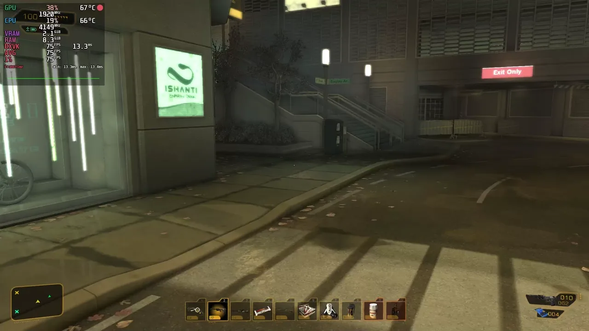
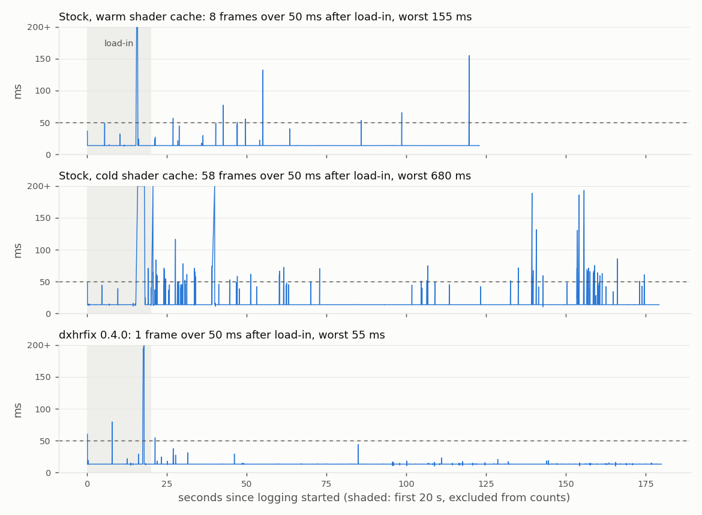
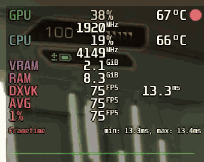
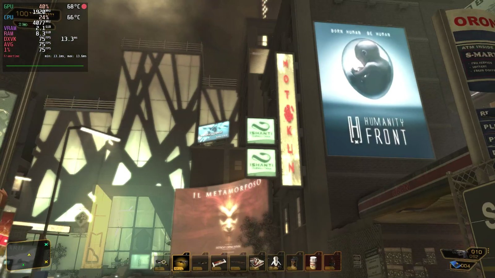
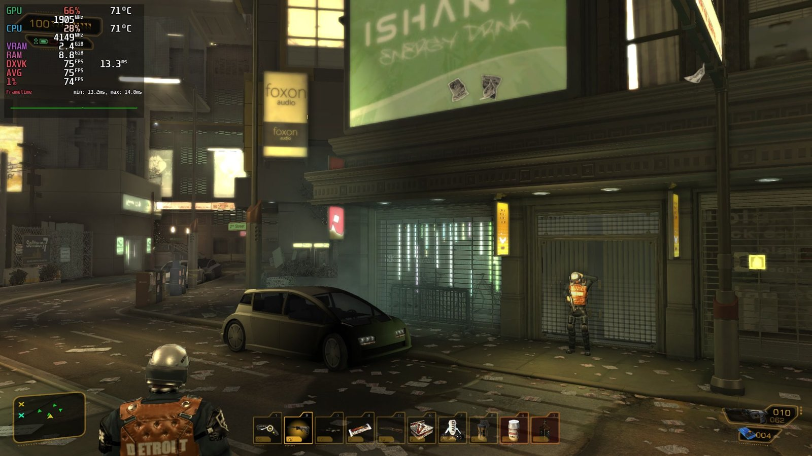
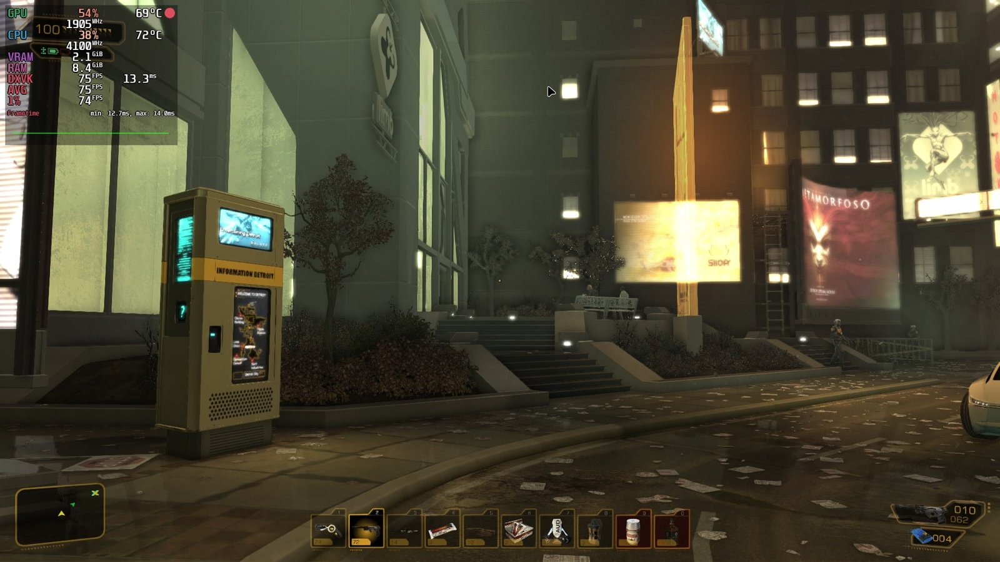

# dxhrfix

**Stutter fix for Deus Ex: Human Revolution Director's Cut.** Built from a disassembly of the game, it patches the engine defects that cause the hitching instead of hiding them. One DLL swap, no loader, no launch options.

<p align="center">
  
  <br>
  <sub>Detroit hub with dxhrfix 0.4.0, 10 s at 30 fps. HUD at the top left: 75 fps, 1% low 74 to 75 fps, frame time flat at 13.3 ms. 1080p60 version: <a href="docs/dxhrfix-detroit.mp4">docs/dxhrfix-detroit.mp4</a>.</sub>
</p>

| Detroit hub, same route | stock | dxhrfix 0.4.0 |
|---|---|---|
| frames over 50 ms per minute | 4.7 to 67 (depends on shader cache state) | 0.4 to 0.8 |
| frames over 100 ms | 2 to 64 | 0 |
| worst frame | 155 to 4337 ms | 55 ms |

Full numbers, chart and method under [Results](#results).

**Install in three steps:** download the zip from the releases page, extract the `dxhrfix-<version>` folder into the game folder, run `install.sh` (Linux) or `install.bat` (Windows) from inside it. Details under [Install](#install), undo with `revert.sh` or Steam's Verify integrity.

## How it works

The game creates shaders and textures on a single background thread and creates pixel shaders only when they are first drawn. Under DXVK (Linux, Proton) this means a pipeline compile in the middle of a frame; on Windows it means the render thread sleeps in 1 ms steps that the OS rounds up to 15.6 ms. dxhrfix creates those resources ahead of time and without sleeping, and removes two other per frame stalls (cursor API spam and a defunct in-game advertising SDK).

It ships as a replacement for `DFEngine.dll`, a DLL the game already loads at startup. At that moment it applies small, byte verified patches to the game in memory. The only file changed on disk is that DLL, and the original is kept next to it.

- Supported: the Steam `DXHRDC.exe` with sha256 `8266b6b4a5bf25f2f4e8de068aa3720f6289c962bb1c2bb70a7b1c111ba510a1`.
- Every patch site is checked byte for byte before it is written. A site that does not match is skipped and logged, and that part of the game runs stock.
- No game files are redistributed. The DLL contains no game code.
- Tested on Linux with Proton 11 (DXVK, NVIDIA). Windows is untested: the DLL is plain Win32, handles ASLR, and the installers have Windows versions, but nobody has run it there yet.

## Install

1. Download `dxhrfix-0.4.0.zip` from the releases page.
2. Extract the zip. You get a folder named `dxhrfix-<version>`. Put that folder inside the game folder (the one with `DXHRDC.exe`), or anywhere else. Do not extract the files loose into the game folder: that would overwrite the original `DFEngine.dll` before it can be backed up.
3. Run the installer with the game not running.

Linux (Steam with Proton): open a terminal in the extracted `dxhrfix-<version>` folder and run

```
./install.sh
```

The installer finds `DXHRDC.exe` in the parent folder on its own. If you extracted the folder somewhere else, pass the game folder as the argument: `./install.sh "/path/to/Deus Ex Human Revolution Director's Cut"`. Steam > Properties > Installed Files > Browse shows where that is.

Windows: double click `install.bat` inside the extracted folder, or run `install.bat "C:\path\to\Deus Ex Human Revolution Director's Cut"` from a command prompt.

The installer checks `DXHRDC.exe` (and asks before continuing on an unknown build), keeps the stock `DFEngine.dll` as `DFEngine_orig.dll`, copies the new DLL, copies `dxhrfix.ini` only if none exists, and copies `dxhrfix_syms.tsv`. It never deletes anything. To update, run the newer release's installer the same way.

No launch options are needed. The game loads `DFEngine.dll` from its own folder.

To confirm it is active, start the game once and open `dxhrfix.log` in the game folder. It should contain `hooks: 10 patches applied` and no `FAILED`, `SKIPPED` or `mismatch` lines.

## Revert

Run `revert.sh` or `revert.bat` from the release folder. It copies `DFEngine_orig.dll` back over `DFEngine.dll` and changes nothing else. Steam's "Verify integrity of game files" also restores the stock DLL. The remaining dxhrfix files are ignored by the stock DLL and can be deleted.

## Results

Measured on one machine (Linux, Proton 11, DXVK, NVIDIA GPU, Ryzen 5 3600X), same walk through the Detroit hub, MangoHud frame time logs with one row per frame. The first 20 s after the loading screen are excluded from the play columns, because that window is DXVK compiling pipelines on every build. Stock numbers vary with shader cache state, so several stock runs are listed.

| run | frames over 50 ms per minute of play | frames over 100 ms during play | worst frame during play |
|---|---|---|---|
| stock, warm shader cache | 4.7 | 2 | 155 ms |
| stock, cold shader cache | 21.9 | 8 | 680 ms |
| stock, cold shader cache, second run | 67.4 | 9 | 172 ms |
| stock, Steam's replayed shader cache | 48.3 | 64 | 4337 ms |
| dxhrfix 0.2 (inline create, precreate) | 3.4 | 8 | 698 ms |
| dxhrfix 0.3 (plus ad SDK off) | 0.7 | 1 | 121 ms |
| dxhrfix 0.4 (plus cursor fix) | 0.8 | 0 | 56 ms |
| dxhrfix 0.4.0 release build, second run | 0.4 | 0 | 55 ms |



In each 0.4 run the one remaining frame over 50 ms was 55 to 56 ms. About 13,000 pixel shaders were created on the precreate pool instead of on the render thread, and the longest time the render thread still had to wait for the worker dropped to microseconds. The stock runs were capped at 72 fps by MangoHud; the 0.3 and 0.4 runs ran at 75 fps (vsync or limiter), which is why their baseline sits at 13.3 ms instead of 13.9 ms.



The MangoHud corner while walking, 8 s at 50 fps.







Frames from the same run, HUD at the top left. The billboards and LCD panels around the hubs are the surfaces the advertising SDK was built to repaint. With `ad_sdk=0` they keep the textures shipped with the game.

The numbers come from `tools/frametime_stats.py` and the chart from `tools/frametime_chart.py`, both reading MangoHud CSV logs. `dev/TEST_PROTOCOL.md` describes the measurement procedure. Results on other hardware, drivers and on Windows are welcome.

## How this differs from other fixes

Existing advice for this game treats the symptom. dxhrfix was built from a disassembly of the exe, so each patch targets a specific engine defect with a known mechanism, and each one was measured on its own.

- **Driver and overlay workarounds** (NVIDIA Fast Sync, Radeon Chill, disabling the Steam overlay, registry edits). Fast Sync and Chill buffer frames so a hitch is hidden behind the queue; the stall still happens. The others have no measurable effect on the stalls described below.
- **[HRDCfix](https://github.com/imring/HRDCfix)** patches the `Sleep(1)` poll in `awaitResource`. That is a real defect and it matters on Windows, where the timer granularity is 15.6 ms. It does nothing about why the render thread waits in the first place (pixel shaders created at first draw on a single worker), it does not touch the cursor or ad SDK stalls, and it needs a separate ASI loader to be injected. Under Wine, where `Sleep(1)` takes about 1 ms, it has no measurable effect.
- **Async shader compilation in DXVK** (dxvk-gplasync) was tested on the same route and made it worse: about 71 frames over 50 ms per minute against 9 for stock, because the game binds the shader and draws with it in the same frame.

dxhrfix instead:

- removes the wait by creating the queued resource on the thread that needs it, and creates pixel shaders before their first draw by hooking the shader library loader;
- fixes a queue publishing race found in the disassembly;
- removes two stalls that no previous fix had identified, the per frame cursor API calls and the defunct advertising SDK's network calls, both found with the built-in sampling profiler rather than by reading code;
- loads through a DLL the game already imports, so there is no injector, no launch option and no second loader to keep working;
- verifies every patch site byte for byte, logs what it did, and ships the frame time logs and scripts behind every number in this README.

The engine analysis is documented in [`spec/`](spec/SPEC.md) and can be regenerated from your own copy of the game with the scripts in [`tools/ghidra/`](tools/ghidra/README.md).

## What it fixes

Findings from disassembly of the exe. Details and addresses are in [`spec/SPEC.md`](spec/SPEC.md) and [`tools/ghidra/ADDRESSES.md`](tools/ghidra/ADDRESSES.md).

1. **One worker thread creates every GPU resource.** Shaders, textures and constant buffers go through a 1024 slot FIFO to a single background thread. When the render thread needs an item the worker has not reached yet, `awaitResource` (0x54C800) polls with `Sleep(1)` until it exists. The exe never calls `timeBeginPeriod`, so on Windows each poll can take up to 15.6 ms.
2. **Pixel shaders are created at first draw.** The game's option to create them up front reads `ShaderUsageDX11.bin`, a file that is not in the shipped game, so that path never runs. About 14,600 pixel shaders exist. On DXVK each first use can mean a pipeline compile inside a frame.
3. **A race in the creation queue.** The request function publishes a queue slot outside the lock the worker reads it under, so under contention the worker can see a half written slot.
4. **Per frame cursor calls.** The UI calls `ShowCursor` in a loop plus `SetCursor` and `ClipCursor` every frame, and its show loop raises the cursor display counter by one per visible frame. Under Wine each call is a wineserver round trip. A profiled 113 ms gameplay frame spent 78% of its time in `ShowCursor`.
5. **The advertising SDK.** `DFEngine.dll` is the Double Fusion in-game advertising SDK. The ad network no longer exists, but the SDK still makes network and connectivity calls on the main thread (profiled at 120 ms frames).
6. **Frame latency 1.** The game hardcodes `SetMaximumFrameLatency(1)`, which leaves no slack when the GPU or the shader compiler hiccups.

What dxhrfix does about each:

| fix | ini key | patch |
|---|---|---|
| Create a queued resource on the waiting thread instead of sleeping (the D3D11 device is free threaded); remove a destroyed queued resource safely | `hooks` | hooks on `awaitResource` 0x54C800 and `cancelOrAwait` 0x54C850 |
| Publish queue slots in order under the engine's own lock | `hooks` | request 0x54C7D0 replaced |
| Create each loaded shader library's pixel shaders ahead of time on a small thread pool | `precreate` | hooks on 0x54F000, 0x54F080, `~PixelShader` 0x54C910, shutdown 0x54A440; helpers 0x5535F0, 0x54C8D0 replaced |
| Frame latency 2 | `frame_latency` | immediate at 0x54AB84 |
| Pass only real cursor changes to Windows | `cursor_fix` | import table slots of `ShowCursor`, `SetCursor`, `ClipCursor` |
| Built-in stub instead of the ad SDK | `ad_sdk=0` | none (the game handles a missing SDK) |
| Optional sampling profiler that reports what slow frames were doing | `profiler=1` | hook on the Present wrapper 0x54C9F0, `ReadFile` import slot |

Remaining stutter after the fix is mostly not shader related: level streaming runs on the main thread, and DXVK can still stall on the first use of some pipelines.

## Configuration

`dxhrfix.ini` in the game folder, section `[dxhrfix]`. Every key is documented in the file. Changes take effect at the next game start.

| key | default | meaning |
|---|---|---|
| hooks | 1 | master switch; 0 = patch nothing |
| precreate | 1 | shader precreate pool |
| pool_threads | auto | pool size; auto = min(4, cores - 2), at least 1; max 8 |
| precreate_max_per_sec | 0 | cap on pool creations per second; 0 = unlimited |
| frame_latency | 2 | 1 to 4; 1 = stock |
| cursor_fix | 1 | cursor call dedupe |
| cursor_refresh_ms | 250 | resend an unchanged cursor or clip rect at least this often |
| ad_sdk | 0 | 1 = forward to the original ad SDK (`DFEngine_orig.dll`) |
| log_level | 1 | 0, 1 or 2 |
| profiler | 0 | hitch profiler, writes `dxhrfix_hitch.log` |
| profiler_hz | 250 | samples per second per thread |
| profiler_hitch_ms | 40 | frames longer than this are reported |
| profiler_max_dumps | 200 | reports per session |
| profiler_ring_ms | 1000 | sample history in ms |
| profiler_extra_threads | 2 | 0 core threads, 1 plus game threads, 2 every thread including DXVK's |
| profiler_readfile | 1 | count `ReadFile` calls per thread |

A missing key uses the built-in default, which is the same except `ad_sdk` (built-in 1, forwarding like stock).

## Launch options

None are required. For benchmarking on Linux, MangoHud can log every frame to a CSV. Set `fps_limit` a few fps under your monitor's refresh rate (72 was used for a 75 Hz display) so every run has the same flat baseline and anything above it is a stall:

```
MANGOHUD=1 MANGOHUD_CONFIG="fps_limit=72,frametime,log_interval=0,log_duration=180,autostart_log=2,output_folder=/path/to/logs" %command%
```

Do not use `PROTON_USE_WOW64=1` with this game. It was measured at about 128 frames over 50 ms per minute against 9 for the default Proton mode on the same route, because the 32-bit NVIDIA driver cannot use Steam's precompiled 64-bit shader cache.

## Reporting a problem

Open an issue with:

1. what happened and where in the game;
2. `dxhrfix.log` from the game folder;
3. for stutter: set `profiler=1` in `dxhrfix.ini`, reproduce, quit, and attach `dxhrfix_hitch.log` together with the `dxhrfix.log` of that session (then set `profiler=0` again);
4. Windows or Linux (Proton version), GPU and driver.

How to read both logs is described in [`dist/README.md`](dist/README.md).

## Building from source

Requirements: `i686-w64-mingw32-g++` 13 (MinGW-w64, win32 thread model is fine), GNU make, and Wine for the tests. On Debian or Ubuntu: `g++-mingw-w64-i686`, `make`, `wine`.

```
make          # builds dist/DFEngine.dll
make test     # hooklib and profiler unit tests, run under wine (wine prefixes in build/)
```

`make harness` runs `dev/harness/test_launch.sh`, which launches the real game under Proton with the freshly built DLL for 60 s and restores the game folder afterwards. Read the script header first and set `STEAMAPPS`, `DXHR_GAME`, `PROTON_DIR` and `COMPAT` for your machine.

`proxy/` also builds a stage 1 variant without patches (`make -C proxy`, `make -C proxy test`), useful to check the forwarding and stub logic on its own.

## Regenerating the analysis

The repository contains no decompiled code and no disassembly of the game. [`tools/ghidra/README.md`](tools/ghidra/README.md) explains how to reproduce the reverse engineering from your own copy of the exe with Ghidra 12.1.4 in headless mode: import and auto analysis, export of the function list, string references and import callers, batch decompilation of the address lists in `tools/ghidra/lists/`, reverse call trees, and the helper scripts used to find vtable calls, D3D11 calls and safe hook prologues. [`tools/ghidra/ADDRESSES.md`](tools/ghidra/ADDRESSES.md) lists the functions to read first, and `tools/gen_syms.py` rebuilds the profiler's symbol file from the Ghidra output.

## Repository layout

| path | content |
|---|---|
| `dist/` | release files: built DLL, ini, symbol file, install and revert scripts, user README |
| `proxy/` | the `DFEngine.dll` proxy: `GetDFEngine` export, forwarding to `DFEngine_orig.dll` or stub, ini, log, startup |
| `hooklib/` | dependency free x86-32 inline hook library with its tests |
| `src/` | the fixes: `dxhrfix_hooks.cpp` (resource creation, frame latency), `dxhrfix_precreate.cpp` (shader precreate), `dxhrfix_cursor.cpp`, `dxhrfix_profiler.cpp` and `dxhrfix_prof_core.*` (profiler), `test/` |
| `spec/` | engine structures, hook sites with expected bytes, threading, streaming notes |
| `tools/ghidra/` | scripts and instructions to regenerate the analysis from your own exe |
| `tools/gen_syms.py` | builds `dist/dxhrfix_syms.tsv` from a Ghidra function list and the exe's RTTI |
| `tools/frametime_stats.py`, `tools/frametime_chart.py` | hitch statistics and the chart above from MangoHud logs |
| `dev/` | Linux test harness and the measurement protocol (`TEST_PROTOCOL.md`) |
| `docs/` | images and clips used in this README |
| `CHANGELOG.md` | version history |

## Related work

- [rrika/cdcEngineDXHR](https://github.com/rrika/cdcEngineDXHR), a source reconstruction of the engine, helped confirm class layouts.
- [HRDCfix](https://github.com/imring/HRDCfix) is an ASI plugin that patches the Windows `Sleep(1)` polling.

## License

MIT, see [`LICENSE`](LICENSE). Deus Ex: Human Revolution is a trademark of its owners; this project is not affiliated with or endorsed by them.
